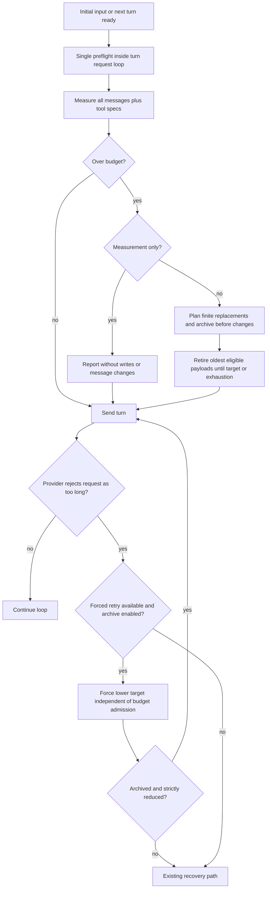

# Automatic in-task context compaction plan

Date: 2026-11-10. Status: implemented and verified with isolated fixtures and mocked providers.
This document records the design for keeping a single task alive when its tool-heavy conversation
grows past a small model's input limit. The feature remains opt-in; live provider behavior is unverified.

## Goal

Inside one user task, the agent loop sends the entire message list on every turn and never shortens
it. A model with a small window will eventually receive a request it cannot accept. The goal is to
detect that before the request is sent, deterministically retire the least valuable historical
payloads, preserve every user instruction verbatim, archive the untouched transcript locally first,
and continue the same task with no user interaction.

Non-goals: replacing the explicit `/save-context` and `-SaveContextPath` flows; changing the
completion-prompt pruning that already exists; semantic retrieval or embedding-based selection;
provider-specific tokenizers; automatic model switching when a task outgrows the window.

## Baseline evidence before implementation

| Observation | Location |
|---|---|
| The loop appends every assistant/tool message and resends the whole list until `-MaxIterations`. | `Public/Invoke-AgentHarness.ps1` (loop at 422-542) |
| No token or size accounting exists; `usage` is only added to running totals. | `Public/Invoke-AgentHarness.ps1` 438-444 |
| Tool results are capped per result, not per conversation. | `Private/AgentHarness/Invoke-AgentHarnessToolCall.ps1` 46-53, `-MaxToolOutputChars` default 8000 |
| Continuation pruning rebuilds the list and keeps user messages plus the latest final answer. | `Private/AgentHarness/New-AgentHarnessMessages.ps1` 10-22, called at `Public/Invoke-AgentHarness.ps1` 491-492 |
| The raw archive survives continuation pruning and is only written by explicit commands. | `Public/Invoke-AgentHarness.ps1` 394-396, 475-476, 543-549; tested at `Tests/AgentHarness.Context.Tests.ps1` 108-110 |
| A validated atomic writer already exists and is reusable. | `Private/AgentHarness/Context/Write-AgentHarnessContext.ps1` |
| The context validator rejects a conversation that ends at a tool result. | `Private/AgentHarness/Context/ConvertTo-AgentHarnessContextMessages.ps1` 69-71 |
| Discovery already returns per-model context length, but candidate objects mostly drop it. | `Public/Get-FreeModels.ps1` 79; `Private/AgentHarness/Get-AgentHarnessCandidates.ps1` 18; `Private/AgentHarness/Select-AgentHarnessModel.ps1` 21 |
| `.agents/prompts/` and `.agents/children/` are already git-ignored; `.agents/harness/` is not. | `.gitignore` |

Conclusion: the loop needs a meter, a deterministic retirement policy, and an archive path that does
not depend on loosening the loader's validation.

## Design decisions

| Decision | Choice |
|---|---|
| Trigger | One preflight before every turn request, plus one forced pass on a classified context-length error |
| Compaction content | Deterministic only: retire content, never call a model to summarize |
| Default state | Opt-in via `-AutoCompact`; no behavior change without it |
| Pre-compaction archive | Always written to `.agents/harness/compaction/<sessionId>/` before retiring anything; `-NoAutoCompactArchive` enables measurement and notices only, with no message changes or automatic resend |
| Archive format | Separate `SpiAgentHarness.Transcript` v1 envelope containing pre-pass `messages` and archive metadata |
| Lower bound | Never drop or rewrite user text; historical user attachment parts may be replaced by a text placeholder, with a warning |
| Plan location | This document |

## Architecture



`Invoke-AgentHarnessTurn` owns the request boundary: evaluate once immediately before each call to
`Invoke-AgentHarnessChat`, after messages and the system prompt are ready. This includes the first
request and every candidate/recovery retry. Message-producing sites only append or rebuild history;
they never compact independently. The turn's catch intercepts context-length errors before changing
candidate state or opening recovery. Every sent list remains a complete, valid message list.

Measurement-only mode (`-NoAutoCompactArchive`) runs the meter and emits an over-budget notice once
per task. It never archives, changes messages, creates pointers, or resends a failed request. Existing
explicit context saves remain available. This preserves archive-first for every destructive pass.

### Module layout

```text
Private/AgentHarness/Context/
    Get-AgentHarnessMessageCost.ps1         private; text, media parts, tool-call arguments
    New-AgentHarnessTranscript.ps1          private; SpiAgentHarness.Transcript v1 envelope
    Write-AgentHarnessTranscript.ps1        private; atomic write, manifest, archive-first step
    Invoke-AgentHarnessCompaction.ps1       private; orchestrator + notices
```

`New-AgentHarnessTranscript.ps1` captures the exact pre-pass message list without completion-only
validation. Later snapshots may contain pointers to earlier archives; keep those earlier files so
retired payloads remain recoverable. It cannot recover reasoning or tool output already omitted or
truncated before messages were stored. The separate `$rawMessages` list remains untouched for explicit
saves. `SpiAgentHarness.psm1` loads private files by sorted full path, so no loader
change is needed. No public function is added, so `FunctionsToExport` and `Update-Manifest.ps1` are
untouched.

### Loop integration

| Site | Line (current) | Action |
|---|---|---|
| Inside the turn, immediately before `Invoke-AgentHarnessChat` | `Invoke-AgentHarnessTurn.ps1` 27-34 | Sole normal preflight, including initial `History`/`ContextPath`, candidate changes and recovery retries |
| Inside the turn's catch, before attempt/candidate mutations | `Invoke-AgentHarnessTurn.ps1` 40-42 | Classify, force compaction when eligible, and resend once only after strict reduction |
| After a tool-result batch and system-prompt refresh | `Invoke-AgentHarness.ps1` 517-536 | Finish every call/result pair and refresh instructions before reaching the next preflight |
| After approval guidance | `Invoke-AgentHarness.ps1` 537-541 | Append protected user guidance before the next preflight |
| After continuation rebuild | `Invoke-AgentHarness.ps1` 502-504 | Update current-prompt/protected-message tracking; next preflight meters the rebuilt list |
| After a final answer without tool calls | `Invoke-AgentHarness.ps1` 455-458 | No pending request, so no preflight or archive; periodic checkpoints are deferred |

Pass optional compaction context into `Invoke-AgentHarnessTurn`; existing callers without it retain
their behavior. Recount the current list at the request boundary, avoiding drift after replacement or
prompt refresh. Use a single eligibility walk and a running total of verified replacement savings
within a pass, followed by one final recount; do not rescan the entire list after each replacement.

## Cost estimation

`Get-AgentHarnessMessageCost` returns estimated characters: string content length; for content arrays,
the sum of `text`, `image_url.url`, `video_url.url`, and `file.file_data` lengths; plus tool-call
`function.arguments`. For an unrecognized content part, count its compact JSON length rather than
silently charging zero. Cover both user attachments and multimodal tool results. Data URL lengths
already include base64 inflation. Structural overhead and provider-specific media token costs are
not accurately modeled; no fixed percentage error or character-to-token conversion is guaranteed.

The turn cost also includes the tool specification, which is static for a task. Cache
`(ConvertTo-Json -Depth 30 -Compress $ToolSpecs).Length` in `$ctx` and add it to every evaluation,
so large tool schemas are included in both the total and the irreducible floor.

Default: `-AutoCompactBudget 131072` characters (128K) is a configurable heuristic, not a model-window
guarantee. The normal target is `max(0, Budget - max(4000, ceiling(10% of Budget)))`. The margin
reduces immediate retriggering but cannot guarantee room for an arbitrarily large tool batch.

## Compaction algorithm

One pass (`Invoke-AgentHarnessCompaction`) receives `reason = budget|too_long` and returns structured
results including `Changed`, `EstimatedBefore`, `EstimatedAfter`, counts and archive path.

1. **Measure and admit.** Recount messages plus tool specs. A normal pass is admitted only when
   total > `Budget`; a forced `too_long` pass is admitted regardless of the character estimate.
   Measurement-only mode reports and returns `Changed = false` without replacements or archives.
2. **Plan eligible replacements.** Enumerate completed tool spans oldest first, then historical user
   media parts oldest first. A span is an assistant `tool_calls` message plus its contiguous, fully
   resolved tool results. Never change assistant prose, system instructions, tool-call arguments or
   IDs, any user text part, current-prompt media, or approval-guidance messages. Track the actual task
   prompt and guidance by message identity in private state; the last user message alone does not
   reliably identify the task prompt. Rebuild that state on continuation. Unknown user content-part
   types are protected until an explicit replacement rule exists.
3. **Calculate savings and floor.** Construct exact candidate pointer/placeholder text using the next
   archive filename and original zero-based message index. Exclude previously retired payloads and
   every replacement whose estimated cost is not strictly smaller. The irreducible floor is total
   minus all eligible positive savings: it includes protected content, tool schemas, assistant prose,
   call metadata, and replacement markers. Historical replaceable media is charged at placeholder
   cost, not its original size. A floor above budget produces a warning but does not prevent useful
   retirement. With no eligible savings, return unchanged without writing an archive.
4. **Choose target.** Normal passes use the normal target. Forced passes use the lower of the normal
   target and `max(0, Before - max(4000, ceiling(10% of Before)))`, ensuring a below-budget failure
   still requests a strict reduction. Clamp either target upward to the irreducible floor.
5. **Select and archive.** Select replacements in order until projected cost reaches the target or
   candidates are exhausted. There is no three-span cap. Build an exact pre-pass snapshot and write
   it atomically before applying any replacement. If the transcript or manifest write fails, return
   unchanged and warn once; preserve any earlier archive and never publish a pointer to a failed
   write. Do not archive no-op passes.
6. **Apply tool retirement, then media replacement.** Replace selected tool message entries with new
   hashtables retaining `role`, `tool_call_id` and `name`. Content is
   `[compacted tool output: <name>, <N> chars, archived as <archive file>#<index>]`, retaining an exit
   code when the original text starts with `exit code: <n>`. Only after eligible tool results are
   exhausted and the target is unmet, replace selected historical image/video/file parts with text
   `[attachment content replaced during compaction: <filename or media type>, <N> chars, archived as <archive file>#<index>]`.
   Copy the user message and its parts array; preserve all text verbatim. Queue one notice per affected
   user message, emitting it only after publication. Images/videos lack filenames in current messages,
   so use the media type as fallback.
7. **Verify and report.** Recount the proposed list, require strict decrease and preserved pairing,
   then publish the replacements as a batch. On verification failure leave live and raw lists
   unchanged. Report counts and before/after size; if still over budget, explain that eligible savings
   are exhausted. A normal preflight then sends the best-effort request; forced recovery only resends
   when `Changed` is true and `EstimatedAfter < EstimatedBefore`.

Progress is bounded by the finite candidate set. Each eligible payload is visited at most once per
pass and can be retired only once; skip exact harness pointer markers and track applied replacements
in private state without adding provider-visible message properties. Every applied replacement saves
characters. Stop at target or exhaustion, with no previous-retirement flag admitting later passes.
Subsequent below-budget turns leave surviving history intact. New payloads may grow the conversation,
so only each compaction transition, not the entire task's size trajectory, is strictly decreasing.

### Provider-error backstop

`Invoke-AgentHarnessChat` builds message `"HTTP $status : $detail"` with `Data['Status']`. A
`400`-class failure whose message matches a context-length pattern (`context length`, `context
window`, `too long`, `maximum context`, `token limit`, `too many tokens`, case-insensitive) is
classified inside `Invoke-AgentHarnessTurn`'s catch, before `$State.Attempts++`, candidate removal,
or `Select-AgentHarnessRecoveryModel`. Keep classification in the private compaction helper (an
explicit classification operation); `Invoke-AgentHarnessChat` and its HTTP retry loop stay unchanged.

- Scope a retry-used flag to one logical assistant turn, covering candidate changes and recovery
  retries. Set it before attempting the forced pass, allowing at most one automatic compaction resend
  for that turn. A new completed tool batch or continuation starts a new logical turn.
- If enabled with archive writing and unused, force `reason = too_long` even below budget. If the
  archive succeeds and actual cost decreases, resend using the same candidate before any recovery
  mutations. Do not increment logical iterations, remove candidates or execute tools from the failed
  request. The retry's normal preflight may measure again, but must not perform a second budget pass
  for this already-prepared resend.
- If unchanged, archive failure, measurement-only mode, retry already used, disabled, or unclassified,
  enter the existing recovery path using the failure being handled. Count/update candidates once for
  the failure entering that path; a successfully intercepted first failure does not consume attempts.
  Never resend an identical request solely for compaction. A second rejection follows existing
  recovery behavior, including `-NoModelRecovery`.
- HTTP 200 error objects that the existing chat helper converts to a numeric 4xx status can use the
  same classifier. Non-standard status codes or unmatched error text fall through; live gateway
  error shapes remain unverified. Tests mock both numeric and unmatched cases.

## Archive format

`SpiAgentHarness.Transcript`, version 1, written under
`.agents/harness/compaction/<contextSessionId>/0001.json`, `0002.json`, and so on, resolved through
`Resolve-AgentHarnessStatePath` (existing reparse-point refusal) with the 64 MiB bound, UTF-8 without
BOM, a flushed temporary file and an atomic move, reusing the writer's shape.

```json
{
  "format": "SpiAgentHarness.Transcript",
  "version": 1,
  "sessionId": "...",
  "parentSessionId": "...",
  "index": 1,
  "reason": "budget",
  "createdAt": "2026-11-10T07:00:00.0000000+00:00",
  "workingDirectory": "D:\\project",
  "provider": "Kilo",
  "model": "some-model:free",
  "budget": 131072,
  "estimatedBefore": 161200,
  "toolSpecCharacters": 9000,
  "promptTokens": 0,
  "completionTokens": 0,
  "messages": [ /* the exact pre-compaction message objects */ ]
}
```

`messages` is stored without validation, because at compaction time the conversation legitimately
ends at a tool result. `Read-AgentHarnessContext` must reject this format with a clear message such
as `Unsupported context format or version.`; an explicit `SpiAgentHarness.Transcript` check gives a
better message: `Transcript archives cannot be loaded with -ContextPath; they are pre-compaction
recovery data.`

A `manifest.json` in the same directory is rewritten atomically on each archive write and lists index,
file, trigger, estimates and time, so recovery does not require parsing each transcript. Complete the
transcript write first, then the manifest write, and only then publish message replacements. A
manifest failure may leave an unreferenced transcript; keep it and reserve its filename rather than
overwriting it on retry. Each session owns its sequence and directory, including child sessions under
an explicitly configured archive root. Do not forward a parent's resolved session directory to a child.

`.gitignore` gains `/.agents/harness/`. Without it, running the harness with `-AutoCompact` in this
repository would leave a multi-megabyte transcript inside a public path, mixing harness bookkeeping
into unrelated diffs.

## Public surface changes

All public parameter additions are to `Public/Invoke-AgentHarness.ps1`.

| Parameter | Value | Purpose |
|---|---|---|
| `-AutoCompact` | switch | Enable preflight and context-error compaction; measurement only with `-NoAutoCompactArchive` |
| `-AutoCompactBudget` | `[ValidateRange(4000, [int]::MaxValue)][int]`, default 131072 (128K) | Estimated character budget per request |
| `-AutoCompactArchivePath` | `[ValidateNotNullOrEmpty()][string]`, default root `.agents/harness/compaction` | Archive root relative to `WorkingDirectory`; append the invocation's session ID |
| `-NoAutoCompactArchive` | switch | Measure and report only; no archive, retirement, pointers, or automatic compaction resend |

Validation, next to the existing `-ContextMode` check: `-AutoCompactBudget`, `-AutoCompactArchivePath`
and `-NoAutoCompactArchive` all throw when supplied without `-AutoCompact`. `-NoAutoCompactArchive`
with `-AutoCompactArchivePath` throws. `$ctx.AutoCompact` is assembled with the other context fields so
custom tools can read it, and the values are copied into `$ctx.SubAgentOptions` so delegated children
get the same policy, matching how `MaxIterations`, `MaxToolOutputChars` and `TimeoutSec` are already
forwarded. `Tests/AgentHarness.SubAgents.Tests.ps1` 31 builds `SubAgentOptions` by hand, so it needs
coverage for inherited enabled and measurement-only modes. Forward dependent parameters only when
enabled and explicitly applicable, so disabled parents do not trigger the new parameter validation.
Treat missing optional keys in older fixtures/callers as disabled; do not require new keys unconditionally.
Forward the configured archive root, letting each child append its own session ID. Pass the current
candidate's provider/model to the archive writer, including before the first successful response.

Documentation-comment additions (`Public/Invoke-AgentHarness.ps1` 49-54) and the corresponding
parameter reference in `Docs/Invoke-AgentHarness.md`.

`-PassThru` gains:

| Property | Meaning |
|---|---|
| `Compactions` | Number of passes that retired content |
| `CompactedSpans` | Tool-result spans retired |
| `CompactedMedia` | Historical user media parts replaced |
| `ContextArchivePaths` | Absolute paths of written archives |
| `PromptTokens` / `CompletionTokens` | Unchanged definition: provider-reported usage only, so tests that assert `20`/`4` stay valid |

## Failure handling

| Condition | Behavior |
|---|---|
| Archive directory or file cannot be written | Abort the pass, warn once, continue uncompacted; nothing is retired |
| Transcript exceeds 64 MiB | Same as an unwritable archive; warn once |
| Protected content/floor alone over budget | Warn once; apply any useful eligible savings, then send best effort; immutable-only input is unchanged |
| Still over budget after eligible replacements are exhausted | Notice and send best effort; do not repeatedly archive unchanged input |
| Provider 4xx classified as context length, retry unused | Force `reason = too_long` regardless of estimate; resend once only after archive success and strict reduction |
| Forced pass has no savings or archive fails | Enter existing recovery without an identical compaction resend |
| Classified error after automatic resend | Existing recovery behavior, respecting `-NoModelRecovery` |
| `-NoAutoCompactArchive` | Measure/report only; all failures follow existing recovery, with no compaction resend |
| Media replacement, `-AutoCompact` on but `-YOLO` off | Notice only; `-AutoCompact` is an explicit opt-in, so no extra consent prompt |
| `-Quiet` | Compaction log lines suppressed; warnings and notices still shown, matching existing warning behavior |

## Identifiers and integrity

Two invariants must hold or the next request is rejected by strict providers:

1. Every assistant `tool_calls[].id` keeps exactly one matching `role = 'tool'` message, and the
   pointer keeps `name` equal to the call's function name.
2. No `role = 'tool'` message exists without a preceding assistant call, and no assistant call is
   left unresolved.

Retirement replaces payloads and never removes messages, so both hold by construction. The pointer
carries the archive file and original zero-based message index; tool-call IDs remain only in their
protocol fields. No schema-level marker is sent. Recognize the exact emitted pointer format when
handling supplied History, and conservatively leave recognized pointers alone.

Sequential tool batches are contiguous by construction (`Invoke-AgentHarnessToolCall` results are
appended in call order at 517-531) and a retired span must be fully completed; partial spans are not
retired.

Implementation trap: `$rawMessages.Add($messages[-1])` stores the same hashtable instance, so
retirement must replace the element in `$messages` with a new hashtable and never mutate the existing
one. For media replacement, also copy the content array before replacing a part; do not mutate shared
nested objects. Mutating in place would silently corrupt the raw archive and violate archive-first.

## Testing plan

A new `Tests/AgentHarness.AutoCompact.Tests.ps1` dot-sourced from `Tests/Invoke-AgentHarness.Tests.ps1`
after `AgentHarness.Context.Tests.ps1`, with a `-AutoCompactOnly` guard alongside the existing
`-ContextOnly` guard pattern (lines 172-250). The `$checks` counter is shared, so the summary at line
1594 keeps working. Fixtures build synthetic messages only; the mocked `Invoke-RestMethod` at 149-169
and `New-HarnessResponse` provide usage `10`/`2` regardless of real size. Budget triggers use synthetic
payload size and `-AutoCompactBudget`; forced triggers use mocked context-length failures independent
of that budget. Run warning paths under normal Continue preference and terminating errors.

Required checks:

1. The system prompt and every user message text reach the provider byte-identical after a compaction.
2. Tool messages become pointers; the pointer's `role`, `tool_call_id` and `name` still pair with the
   originating assistant call, and the archived file holds the full original payload.
3. The archive is written before retirement and contains the retired payload; corrupting the archive
   path (for example a path under an existing reparse point) aborts the pass with no retirement.
4. Every applied replacement and complete compaction strictly reduce estimated cost; repeat evaluation
   of unchanged compacted input neither rewrites pointers nor creates another archive. Allow growth
   from new messages rather than asserting whole-task monotonicity.
5. At least fifteen 8,000-character tool spans reduce to target in one pass, removing the three-span
   cap. Small/no-savings results remain unchanged. Subsequent below-budget turns retain surviving
   history; another budget breach admits a fresh pass.
6. An immutable user text alone above budget emits one warning and remains intact. A historical media
   part alone above budget remains eligible and shrinks to its placeholder; current-prompt media stays
   protected even after approval guidance becomes the last user message. Include a large tool schema
   and assistant/call metadata in irreducible-floor checks.
7. With `-AutoCompact` off, one long task produces the same request payloads as today, which protects
   the current default.
8. Media replacement only occurs when eligible tool savings cannot reach target; user text, current
   prompt and guidance are untouched. Preserve filenames when present, otherwise name the media type.
   Meter text/image/video/file user and tool parts, including large `video_url.url`, and count unknown
   parts via JSON fallback while keeping unknown user parts protected. Verify raw nested arrays remain
   byte-identical after retirement.
9. An underestimated, below-budget request rejected with a classified 400 forces reduction and one
   resend of the same candidate before recovery. Assert candidate list, lock state and attempt count
   are unchanged for that intercepted failure, with no duplicate tool execution or iteration charge.
   A second rejection, no savings, archive failure, disabled compaction, or measurement-only mode goes
   straight to existing recovery; assert menu counts and `-NoModelRecovery` behavior. Cover unlocked
   initial candidates, locked candidates, replacement candidates, numeric errors carried by HTTP 200,
   and unmatched errors. No second automatic resend across candidate changes in the same logical turn.
10. Unwritable/oversized archives and exhausted savings leave valid messages and do not themselves
    throw. With a mocked accepting provider the task still returns normally; a real provider rejection
    may still fail under `-NoModelRecovery`. A manifest failure leaves live messages unchanged, and its
    reserved transcript filename is never overwritten.
11. Archive files are UTF-8 without BOM, leave no `.tmp` file behind, and `-ContextPath` on a
    transcript file gives the format-specific message.
12. `Tests/AgentHarness.Context.Tests.ps1` line 35 still passes, and `Docs/Invoke-AgentHarness.md`'s
    statement that there are no automatic context writes is updated to be opt-in scoped.
13. Large initial `History` and `ContextPath` are compacted before the first mocked provider request;
    continuation, system refresh, guidance and recovery requests all use the single preflight boundary.
    The prepared forced resend performs no additional budget compaction.
14. Measurement-only mode reports over-budget input once and leaves request bodies, raw history,
    compaction counts and archive paths unchanged/empty; no filesystem writes by compaction and no
    automatic compaction resend. Existing explicitly requested saves continue to work separately.
15. Missing optional compaction context/child-option keys retain disabled behavior. Enabled children
    inherit the policy and configured root but use independent session directories and manifests.
16. Cover budget 4000 (normal target zero), a floor above target, no positive savings, and many spans;
    every pass terminates at target or exhaustion without a prior-progress admission flag.

## Documentation changes

`README.md` 25-27 (add the opt-in bullet and pointer); `Docs/Invoke-AgentHarness.md` 49-54 comment
parity, the parameter reference, a new `### Automatic in-task compaction` subsection under
`## Saving and loading conversation context` (819-859) covering the algorithm table, notices, the
archive format and the `-ContextPath` refusal, and the qualification of "There are no automatic
context checkpoint writes" at 843. `.gitignore` gains one line.

## Work breakdown

| Phase | Work | Files |
|---|---|---|
| 1 | Estimator, transcript envelope, writer, unit checks | 3 new private files, `Tests/AgentHarness.AutoCompact.Tests.ps1` |
| 2 | Orchestrator, parameters, `$ctx` wiring, protected-message tracking, optional child forwarding, sole request preflight | `Invoke-AgentHarnessCompaction.ps1`, `Public/Invoke-AgentHarness.ps1`, `Private/AgentHarness/Invoke-AgentHarnessTurn.ps1`, child forwarding helper if needed |
| 3 | Forced error backstop before recovery mutations, one-resend guard, measurement-only notices | orchestrator, `Private/AgentHarness/Invoke-AgentHarnessTurn.ps1` |
| 4 | Tests 1-16 and the `-AutoCompactOnly` guard | test file, `Tests/Invoke-AgentHarness.Tests.ps1`, `Tests/AgentHarness.SubAgents.Tests.ps1` |
| 5 | Documentation, git-ignore, verification run | `README.md`, `Docs/Invoke-AgentHarness.md`, `.gitignore` |

## Verification

```powershell
pwsh -NoProfile -File ./Tests/Invoke-ModuleIntegration.Tests.ps1
pwsh -NoProfile -File ./Tests/Invoke-AgentHarness.Tests.ps1
pwsh -NoProfile -File ./Tests/Invoke-AgentHarness.Tests.ps1 -ContextOnly
pwsh -NoProfile -File ./Tests/Invoke-AgentHarness.Tests.ps1 -AutoCompactOnly
pwsh -NoProfile -File ./Tests/Invoke-DecisionModel.Tests.ps1
```

Console dependency tests are not required unless `Private/Console/` or `Private/Sound/` changes. Live
MCP smoke scripts remain opt-in and are not part of this work. Finish with `git diff --check` and
report results and material limitations, per `AGENTS.md`.

Implementation verification on 2026-11-10 using PowerShell 7.6.9:

- Module integration: 20 checks passed; full harness: 1585 checks passed; decision model: 512 checks passed.
- Focused context regression: 244 checks passed; focused auto-compaction: 240 checks passed.
- Tests used isolated fixtures, synthetic files and mocked provider requests. Harness/context suites
  ran through approved execution outside the sandbox because archive writes and junction fixtures
  were blocked inside it. No live provider or MCP smoke requests were made.
- Scoped working-tree and index `git diff --check` plus UTF-8 without BOM, CRLF, trailing-whitespace
  and final-newline checks passed. Actual PowerShell 7.0 execution remains unverified.

## Deferred

- Token-accurate estimation or a pluggable estimator; the initial design uses a character heuristic.
- Automatic per-model budgets from the discovery `Context` field, which would need
  `Get-AgentHarnessCandidates` (line 18) and `Select-AgentHarnessModel` (line 21) to stop discarding
  it, and a default that scales for a `$null` hint.
- Periodic checkpoints at the completion prompt; continuation already prunes, and extra writes need
  their own justification.
- Semantic or embedding-based retention: not deterministic, not testable here.
- Automatic model switching when a single turn's own content exceeds a window.

## Implementation defaults and remaining limits

- Use the configurable 131072-character (128K) default and target margin specified above. Per-model
  budgets remain deferred; the backstop cannot guarantee success when protected content fills the window.
- Retain archives indefinitely in this version. Later snapshots can reference earlier files, so
  pruning requires reference-aware retention rather than deleting the oldest N blindly.
- Use the documented text pointers inside existing content fields; do not add provider-visible
  schema properties. Measurement-only mode produces no pointers.
- Allow `-AutoCompact` alongside `-SaveContextPath`: automatic snapshots and explicit context exports
  use separate formats and paths. Explicit exports continue to read untouched `$rawMessages`.
- The implementation follows this design. Character estimates and provider error classification remain
  heuristics; verification covers synthetic cases and does not establish live gateway compatibility.