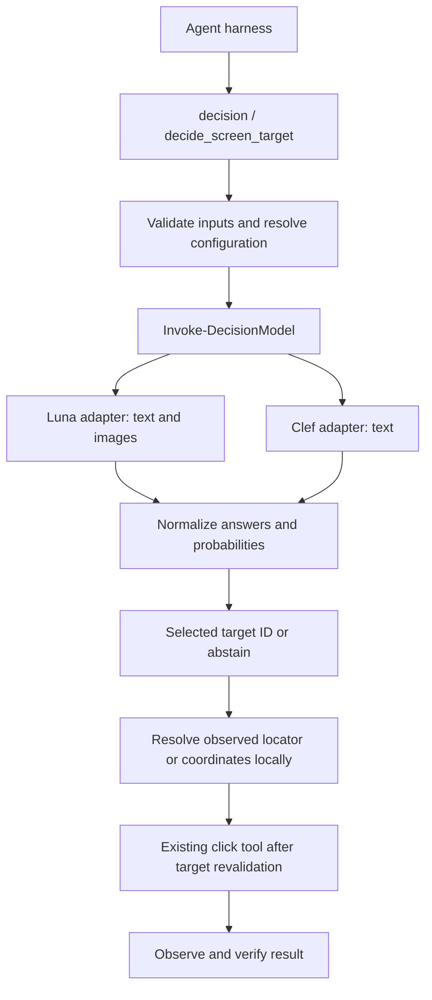

# Configurable decision tools plan

Date: 2026-11-08. Status: architecture implemented with isolated mocked validation; live endpoint and UI execution remain unverified. This document preserves the original proposal; see [DecisionTools.md](DecisionTools.md) for current behavior and extension instructions.

## Goal

Extend the existing `Invoke-DecisionModel` foundation with configurable Experiential decision-model adapters and harness tools. Keep the primary conversational model unchanged. Support general typed decisions and selecting an observed screen target to click.

The `decide_screen_target` tool definition and its configuration live together in [Config/decide_screen_target.json](../Config/decide_screen_target.json). The harness loads this declarative package through `-DecisionConfigPath` and resolves its registered private handler. [Config/decision.json](../Config/decision.json) supplies the general-purpose tool. Neither JSON file contains executable code.

## Architecture

Reuse existing request validation, provider registration, result metadata, and HTTP error handling where compatible. Preserve the existing OpenRouter command contract and defaults. Dispatch by an explicit protocol profile rather than guessing a wire format from the hostname or model name.

| Profile | Model | Input | Endpoint | Adapter responsibility |
| --- | --- | --- | --- | --- |
| luna | gpt-6-luna-decisions | Text and images | https://api.experientiallabs.ai/v1/decisions | Convert named questions into ordered questions; encode images as inline input_image parts; map ordered answers and refusals back to names. |
| clef | clef | Text | https://api.experientiallabs.ai/v1/systemone | Serialize state and named typed questions; normalize native answers; reject image input. |

The existing command uses OpenRouter state/questions maps, noul/choice/score, and image_url parts. A URL change alone cannot adapt it to Luna. Before implementation, confirm the exact native Clef request and response schema: its model description documents systemone while its generic quickstart suggests chat. Do not implement against the conflicting generic quickstart.

## Configuration

Keep the screen tool's model profiles, endpoint URLs, credential environment-variable names, timeouts, request limits, and selection policy in `Config/decide_screen_target.json`, alongside its input and output contracts. The proposed JSON format is versioned and marked as a draft.

Proposed harness integration adds `-DecisionConfig` for a hashtable and `-DecisionConfigPath` for a JSON file, with at most one supplied. Resolution order is built-in defaults, then the supplied configuration. The loaded configuration activates the tools. The screen tool uses the `decide_screen_target` configuration section; the general decision tool can reuse named model profiles. Thresholds in the sample configuration are provisional and need evaluation.

Resolve credentials only from the configured environment variable. Keep credentials, endpoint URLs, and model profiles out of model-supplied tool arguments. Validate HTTPS endpoints without embedded credentials. Use bounded timeouts and zero automatic retries for new Experiential routes by default; do not silently fall back to another model. Preserve existing OpenRouter retry behavior.

## Tool behavior

- `decision`: evaluates supplied state using predicate, choice, or score questions, with adapter-specific translation and capability checks.
- `decide_screen_target`: evaluates a goal against observed candidates and an optional screenshot; returns a selected candidate or an explicit non-selection status.

For the screen tool, candidates come from DOM/accessibility data or identified screenshot regions. Each candidate has a unique stable ID, a description, and an observed locator or bounds. Validate IDs and reserve `none` for abstention. Add a `none` option locally before submitting the choice question. Enforce the profile's option limit including that option; never silently truncate candidates.

Luna may receive a screenshot plus candidates. Clef receives descriptive text candidates and cannot accept screenshot input. If only a raw screenshot is available, a separate observation/perception step must first identify candidate regions. Arbitrary coordinate generation is outside the initial contract.

The input snapshot records its ID, capture time, source, coordinate space, and viewport dimensions. Bounds use x/y/width/height in that coordinate space. Browser CSS coordinates, screenshot pixels, and physical desktop pixels must not be mixed; cropped/scaled screenshots require an explicit transform before click execution. Prefer a current DOM/accessibility locator when available.

Validate the returned ID against the original candidate set, apply configured probability and margin thresholds, and resolve the selected candidate's locator or bounds locally. Never accept coordinates invented by the decision response. Return an abstention when required probabilities are unavailable, confidence is insufficient, or the model selects none. Preserve refusal and stale-snapshot statuses separately. Report provider errors through existing sanitized tool error handling.

Include the snapshot ID, selected target, available probability information, served model, request ID, usage, and elapsed time in the result. Probability is a model estimate, not an execution authorization. The decision tool itself does not click. An existing MCP click tool revalidates the target against the current UI, executes under the harness's existing permissions, and observes the result.

## Image handoff

Current harness MCP result normalization omits binary images. Start with explicit local screenshot files resolved against the harness working directory. If capture tools return only image blocks, add a targeted image bridge before claiming end-to-end support. Do not assume images omitted from the transcript are available to the decision helper.

## Implementation sequence

1. Confirm model-specific native schemas and response examples using authoritative provider documentation.
2. Add protocol/capability profiles and small request/response adapters under `Private/DecisionModels/`; extend `Invoke-DecisionModel` and model discovery without changing existing defaults.
3. Add configuration loading, screen input validation, and decision-tool handlers under `Private/AgentHarness/Decisions/`; wire opt-in registration into the existing tool table and invocation context.
4. Implement the JSON contract in `Config/decide_screen_target.json`, including runtime validation rather than relying only on the schema advertised to the model.
5. Connect snapshot/candidate inputs and local screenshot handoff to existing MCP observation tools; support click revalidation and result verification through the existing executor.
6. Update `Docs/Invoke-DecisionModel.md`, `Docs/Get-DecisionModels.md`, and `Docs/Invoke-AgentHarness.md` with working examples and capability limitations. If new public commands are needed, add one file per command and regenerate/review manifest exports with `Update-Manifest.ps1`.

## Verification and completion criteria

Use isolated module fixtures that omit `Initialize.ps1` and replace bootstrap side effects. Use synthetic images/UI snapshots and mocked HTTP; do not send repository contents or credentials to a live model.

Cover both wire formats, request/response translation, preserved empty/singleton arrays and nulls, unsupported image input, ordered answers, refusals, invalid or missing probabilities, unknown candidate IDs, option limits, stale snapshots, coordinate transforms, and sanitized HTTP/transport failures. Verify no automatic request replay for the new routes. Exercise tool failures with normal Continue preference and terminating errors.

Run `pwsh -NoProfile -File ./Tests/Invoke-DecisionModel.Tests.ps1` and `pwsh -NoProfile -File ./Tests/Invoke-AgentHarness.Tests.ps1` after implementation. Verify isolated loading/exports and `git diff --check` with `Initialize.ps1` explicitly excluded. Maintain PowerShell 7.0 compatibility and repository formatting: UTF-8, four spaces, CRLF, no trailing whitespace or final newline. Leave the user's Git index unchanged.

Live endpoint compatibility and end-to-end click behavior remain unverified until real responses and observed UI results are available. Saving this proposal does not enable tools or authorize a live inference test.

## References

- [Experiential Luna Decisions model](https://platform.experientiallabs.ai/models/gpt-6-luna-decisions)
- [Experiential Clef model](https://platform.experientiallabs.ai/models/clef)
- [Experiential machine-readable reference](https://platform.experientiallabs.ai/llms.txt)