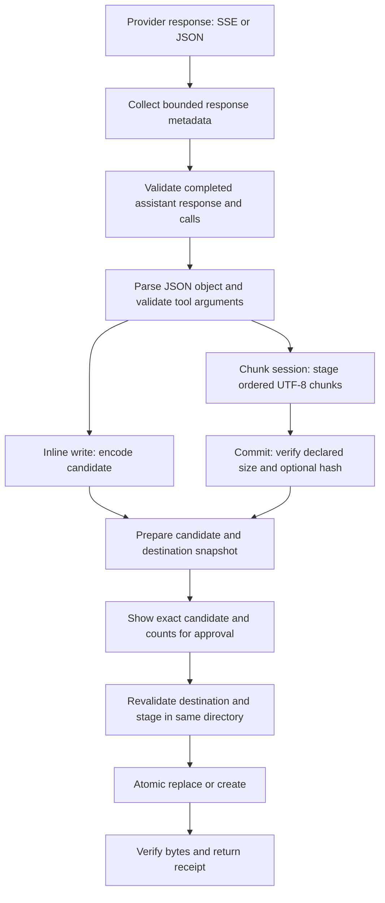

# Reliable file writes plan

Date: 2026-11-16. Status: implemented and verified with isolated synthetic regression tests. This document preserves the design; see [Invoke-AgentHarness.md](Invoke-AgentHarness.md#exact-and-large-file-writes) for current contracts and usage.

## Outcome and confirmed requirements

Make file writes reject invalid arguments, preserve exact supplied text, detect incomplete responses before tool execution, and support large model-authored files through transactional chunks. Provide enough local evidence to distinguish shorter provider output from harness data loss.

The user confirmed that chunked writes belong in this implementation scope and that exact content, without an automatically added trailing newline, becomes the default for `write_file`.

## Evidence and boundaries

- Synthetic tests through the real streaming reader, argument conversion and writer accepted 102,400 ASCII bytes and 168,000 Unicode bytes. These tests did not measure live provider generation capacity.
- Missing, null and explicit empty `content` all currently become an empty string. The schema advertises required strings, but the dispatcher only checks JSON object shape. Invalid calls can overwrite a file and report success.
- `Set-Content` adds a platform newline. The graded artifacts were two bytes longer than their reported ASCII content lengths, consistent with appended CRLF on Windows.
- Streaming rejects tool calls whose completion reason is `length`. Buffered responses can dispatch valid-JSON tool calls with that reason. JSON fallback needs the same completed-response checks.
- The graded files establish their final sizes, not a 16 KB transport cap. A valid shorter call may have been generated shorter by the provider; no captured boundary measurements establish where the discrepancy arose.

Do not promise a universal provider payload ceiling or claim to recover content the provider never returned. A byte count or hash supplied by the same model is a declared constraint, not independent proof that the user's intended content is complete.

## Architecture



All helpers remain private. Keep tool declarations in `Get-AgentHarnessBuiltinTools.ps1`, move write behavior into `Private/AgentHarness/Files/`, and keep transport validation with the chat helpers. Store write sessions on the invocation context, initialized during invocation rather than module import. Custom tools and MCP schemas retain their existing contracts; this work does not impose a new JSON Schema dialect on all integrations.

Reuse the approval, guidance, path-containment and atomic replacement patterns already used by `edit_file`. Extract only the primitives needed by both paths; do not inherit `edit_file`'s 1 MiB cap or encoding-preservation policy into whole-file writes.

## 1. Validate arguments before any write

- Add a shared file-write argument validator with exact allowed property names and consistent errors. Invoke it before approval or filesystem mutation, including when handlers are invoked directly in tests.
- Require `path` to be a nonblank string and `content` to be present and a string. Reject missing content, null, arrays, objects and implicit number/boolean conversions. Keep explicitly supplied `content: ""` valid for creating an empty file.
- Set `additionalProperties: false` and useful property descriptions in the advertised schemas; enforce these constraints locally instead of depending on provider schema compliance.
- Add optional `expected_bytes` and `expected_sha256` to inline writes. Validate their types and formats, and check the encoded candidate before approval. A mismatch returns an error without changing the destination.
- Define counts precisely: `chars` means .NET UTF-16 code units; `bytes` means UTF-8 bytes; neither is a model token count. Use strict UTF-8 encoding to reject unpaired surrogates instead of silently replacing them.
- Keep JSON arrays intact during parsing and continue requiring the argument root to be a JSON object.

## 2. Exact, atomic inline writes

- Encode UTF-8 without BOM and write exactly those bytes. Add no newline, normalize no existing newline, and make explicit empty content a zero-byte file.
- Replace the inline `Set-Content` implementation with a shared candidate-save helper. Both inline and chunked commit use the same approval and save path.
- Resolve the destination within the working root. Reject directories, unsupported alternate data streams, read-only targets and reparse-point traversal, including existing ancestors of a new destination. Recheck before saving.
- Snapshot whether the destination exists and, if present, its original bytes/hash and relevant metadata before approval. Detect changes made while approval is pending and while staging. If an absent destination appears, return a conflict rather than overwriting it.
- Display the proposed content and its byte/character counts. Large candidates need a complete paged local review path; a summary or excerpt must be labeled and must not masquerade as the full review. Existing approval guidance must still cancel stale pending actions.
- Create requested parent folders only after approval. Stage the candidate in the destination directory, flush and close it, then atomically replace an existing target or create a new target without overwrite. Preserve existing permissions where supported, following the existing edit helper pattern.
- On save failure, clean owned temporary files and never fall back to truncating the destination in place. Track newly created empty directories for conservative cleanup on failure; never delete pre-existing directories.
- Return a compact receipt with path, encoded/written byte counts, character count and SHA-256 after successful verification. If post-save verification fails, report that a change may already have occurred; do not imply rollback or automatically replay it.
- Document the remaining external-process race between final destination validation and replacement. These tools are not an operating-system sandbox or a cross-process compare-and-swap filesystem API.

## 3. One response-completion gate for all transports

- Normalize SSE and buffered JSON to the same response contract and validate it in `Invoke-AgentHarnessChat` before returning it to the turn loop.
- Reject incomplete or failed responses before dispatching any call from that response. Cover `length`, `content_filter`, refusal/error payloads, missing finish reasons, malformed tool arrays, missing names/IDs, duplicate call IDs and malformed/non-object argument JSON.
- Require `tool_calls` completion for responses containing function calls, matching current streaming behavior. Do not execute an earlier valid call if a later call in the same response is malformed or the response is incomplete.
- Keep semantic argument errors as ordinary tool errors; they must not trigger provider retries or model fallback. Validate the response envelope as a batch, then validate individual tool contracts before their handlers run.
- Preserve existing pre-output HTTP retry behavior. Incomplete responses with returned assistant content or tool fragments must not enter automatic replay, fallback or compaction retry. Distinguish a completed provider response marked `length` from an interrupted stream in the user-facing error.
- Keep existing response bounds and timeouts; report which bound was exceeded. Do not increase limits or add provider-specific output-token parameters without separate evidence and compatibility checks.

## 4. Diagnose payload delivery without retaining new content logs

- Add an opt-in local diagnostic mode, proposed as `-ToolPayloadDiagnostics`, propagated to child invocation options. Use the information stream and existing Quiet behavior; do not log raw prompts, payload bodies, headers, credentials or complete provider responses.
- Correlate provider/model, invocation, turn and call ID. Record finish reason, transport, provider-reported usage, aggregate argument fragment length/count, assembled argument length, parsed content presence/type, encoded content bytes/hash and final write receipt.
- Bound diagnostics to a summary per call and response, not an event for every fragment. Explain that provider token usage is not proof of delivered content length.
- Compare concatenated fragment and assembled-argument metrics locally. Compare parsed UTF-8 bytes/hash with staged and final file bytes/hash. Raw JSON argument length is expected to differ from decoded content length because of escaping and metadata.
- Keep hashes and detailed metrics local to the diagnostic flow unless they are part of the normal file receipt. Avoid new persistent diagnostic files by default.
- Provide a diagnostic recipe using a locally generated synthetic reference with independently known byte count/hash. Report the earliest measurable mismatch. Provider generation versus upstream provider/gateway alteration remains unresolvable without evidence from that upstream boundary.

## 5. Transactional chunked writes

Expose these built-in tools only when writes are enabled:

| Tool | Inputs | Behavior |
| --- | --- | --- |
| `begin_file_write` | `path`, required `expected_bytes`, optional `expected_sha256` | Validate the destination, snapshot it and create an invocation-owned staging session; return `write_id` and chunk limits. |
| `write_file_chunk` | `write_id`, `offset_bytes`, `content` | Validate and append an ordered UTF-8 chunk to staging; return accepted bytes, next offset and progress. |
| `get_file_write_status` | `write_id` | Return session state, expected/received bytes, next offset and any terminal receipt; never return staged content. |
| `commit_file_write` | `write_id` | Check total size/hash, prepare complete review, obtain existing approval and save atomically through the shared helper. |
| `abort_file_write` | `write_id` | Delete owned staging data and mark the session aborted; never alter the destination. |

`write_id` is an opaque locally generated ID. The destination and expected total become immutable after begin. Staging writes are internal implementation work; the user approves the complete destination change at commit, with YOLO retaining its existing meaning. There is no separate confirmation for each chunk.

Chunk offsets count encoded UTF-8 bytes. Require each string to be independently valid Unicode and reject an oversized chunk before appending it. Reject gaps, overlaps and conflicting retries. Repeating an identical previously accepted chunk at its original offset returns the original acknowledgement without duplicating bytes. Bind retries to exact stored bytes, not just the requested offset.

Require exact `expected_bytes` at commit. Zero-byte writes commit without chunks. Optional expected SHA-256 is useful when an independent reference exists; compute actual hashes locally. Never ask the model to invent a checksum to satisfy the API. A shorter generated file fails its declared size check instead of being silently committed.

Use states `open -> committing -> committed`, plus `aborted` and `failed`. A validation-only commit rejection leaves the open session available for correction. Denied approval or redirect aborts the candidate. Repeated successful commit returns the stored receipt without rewriting or prompting. An uncertain post-save verification outcome is terminal and must report uncertainty. Duplicate abort is safe. Reject appends after terminal states and IDs from another invocation or child.

Proposed operational defaults are a 4 KiB UTF-8 chunk limit, 16 MiB total per file, four active sessions and 64 MiB staged bytes per invocation. These are local resource policies, not inferred provider limits. Expose validated invocation-level configuration, proposed as `-FileWriteOptions`, and return effective limits from begin. Bound serialized call arguments separately, allowing JSON escaping overhead. Avoid repeated whole-file hashing on every append; hash incrementally where practical and verify at commit.

Keep staging outside the target path until commit, in a private invocation-owned temporary directory. Validate ownership and containment during cleanup. Clean up on abort, denial, failure and invocation `finally`; retain at most 256 terminal receipts until invocation ends, rejecting new sessions at that bound rather than evicting retry evidence. Process termination may leave temporary files, which must be documented. Cross-invocation resume, automatic stale-directory sweeping and live session restoration from saved conversation history are outside this first release. Ordinary in-memory continuation/compaction keeps the same session registry.

Honor `-AllowWrite:$false`, `-NoBuiltinTools`, custom tool overrides, parent/child permission inheritance and `-NoPromptSound`. Child processes get separate registries. Never route denied writes through Python or shell tools to evade approval.

## 6. Prompt and documentation changes

- Update the system prompt and tool descriptions: targeted changes use `edit_file`; small deliberate whole-file writes use exact `write_file`; large model-authored files use staged chunks; deterministic generated data can use an approved local script.
- Explain that Python variables do not persist into a subsequent tool call. Printing a byte count does not transfer the generated bytes.
- Require checking acknowledgements/offsets and the final commit receipt. Starting a session or receiving a chunk acknowledgement is not a completed file write.
- Do not batch dependent begin/chunk/commit calls before receiving their required IDs and offsets. Several independent actions can still use existing batching semantics.
- Document exact empty-file behavior, the removed implicit newline, bytes versus characters versus tokens, declared completeness checks, failure states, configuration limits and diagnostic interpretation in `Docs/Invoke-AgentHarness.md`.
- Update parameter help and any relevant tool tables/counts. These are model tools and private helpers, not new public PowerShell functions; no export change is expected. If public functions become necessary, use `Update-Manifest.ps1` and review its diff.

## Implementation order and file ownership

1. Add synthetic regressions for invalid content, exact newline behavior and buffered incomplete responses. Fix local argument validation and the shared response gate first.
2. Implement private candidate encoding, review, destination snapshot and atomic save helpers. Move `write_file` to that path and add declared size/hash checks and receipts.
3. Add bounded payload diagnostics across streaming assembly, response validation, dispatch and save. Add invocation parameters/context wiring and child option propagation.
4. Implement the session registry and five staged tools, including retry receipts, limits, permission gating and cleanup. Wire cleanup into `Invoke-AgentHarness`'s existing `finally` path.
5. Update prompts, docs, help and tests. Review that approval and custom/MCP compatibility have not changed unintentionally.

Primary implementation files: `Private/AgentHarness/Get-AgentHarnessBuiltinTools.ps1`, `Invoke-AgentHarnessToolCall.ps1`, `Invoke-AgentHarnessChat.ps1`, `Streaming/Add-AgentHarnessChatChunk.ps1`, `Streaming/Read-AgentHarnessChatStream.ps1`, new private file-write helpers, and `Public/Invoke-AgentHarness.ps1`. Reuse the existing atomic edit primitives only where their contracts match.

## Verification and acceptance

Use isolated fixtures, synthetic contents and in-memory provider responses only. Do not load user configuration/global skills, call live providers or read protected initialization scripts. Preserve PowerShell 7.0 support and the repository's UTF-8, CRLF, four-space, no-final-newline format.

| Area | Required evidence |
| --- | --- |
| Argument validation | Missing/null/wrong-type content, blank paths and unknown keys fail before approval or destination changes; explicit empty content creates exactly zero bytes. |
| Exact writes | Independently compare bytes/hash for ASCII, Unicode, escaped JSON characters, LF/CRLF/mixed newlines, trailing/no trailing newline and invalid surrogate rejection. |
| Sizes and delivery | Exercise values below/above 16 KiB, 100 KiB and at least 1 MiB through mocked SSE and JSON paths. Generate expected bytes locally and compare every boundary; include many small SSE fragments and escaped content. |
| Response completion | SSE, JSON fallback and NoStream reject length/filter/refusal/incomplete/malformed responses with zero tool side effects and no automatic replay; preserve valid response ordering and ordinary HTTP retry behavior. |
| Atomic save | Denied approval, custom guidance, target changes during approval/staging, new-target appearance, permission/disk-write/replacement failures and invalid paths preserve destination bytes. Assert temporary-file cleanup and clear post-save uncertainty reporting. |
| Chunk sessions | Ordered multi-chunk success, Unicode boundaries, wrong offsets/size/hash, exact/conflicting duplicate chunks, zero-byte commits, duplicate commits/aborts, unknown/cross-invocation IDs, quotas, continuation/compaction and cleanup all behave as specified. |
| Permissions and output | Quiet still permits required approval; YOLO skips approval; NoPromptSound works; disabled writes hide all mutation tools; child registries are isolated; receipts/status remain complete under output limits or return an explicit error. |
| Diagnostics | Metrics locate injected assembly/content mismatches, do not mislabel a shorter valid provider output as transport truncation, and do not expose raw payloads or credentials. |

Extend `Tests/Invoke-AgentHarness.Tests.ps1` with a focused file-write suite and extend `Tests/AgentHarness.Streaming.Tests.ps1` for transport parity. Replace existing `.Trim()` assertions for writes with exact byte comparisons so newline regressions cannot be hidden.

Run the required regression commands after implementation:

```powershell
pwsh -NoProfile -File Tests/Invoke-ModuleIntegration.Tests.ps1
pwsh -NoProfile -File Tests/Invoke-AgentHarness.Tests.ps1
pwsh -NoProfile -File Tests/Invoke-DecisionModel.Tests.ps1
```

Run console dependency tests only if console helpers change. Check `git diff --check`, review only the touched-file diffs, and report passed checks and remaining limitations. Do not stage, unstage or commit changes; preserve the user's index and existing untracked work.

Acceptance means invalid calls cannot silently empty a file, all successful writes match their encoded supplied content exactly, incomplete provider responses cannot execute tools, and a model-authored file above 100 KiB can be assembled and atomically committed through bounded chunks with independently verified synthetic integrity. Live provider reliability remains unverified until an explicitly authorized synthetic smoke test is requested.

## Implementation record

Implemented strict file arguments, exact UTF-8 saves, destination conflict checks, atomic replacement, complete paged approval, size/hash constraints and verified receipts. The five staged tools use invocation-owned private temporary directories, bounded sessions, ordered byte offsets, identical retry receipts, locally verified chunk hashes and terminal cleanup. Both continuation and actual archive-backed compaction preserve live sessions. Begin refuses to create a session when its receipt cannot fit the output limit.

SSE, JSON fallback and buffered calls share completion validation; incomplete/malformed responses cannot execute any calls or enter automatic replay. Existing pre-output transient error retries remain intact. Opt-in metadata diagnostics cover completion, streamed fragment assembly, parsed content, encoding and disk verification, including failure boundaries.

Validation on 2026-11-16: 2,389 harness checks passed, including synthetic SSE/JSON writes through 1 MiB, a chunked write above 100 KiB, Unicode boundaries, exact newlines, validation failures, duplicate/conflicting retries, private staging ACLs, junction rejection, approval paging/guidance, destination races, uncertain post-save outcomes and cleanup on normal/failure/iteration-limit exits. The required standalone integration and decision-model suites passed. Formatting and `git diff --check` passed. Junction fixtures required running the isolated harness suite outside the filesystem sandbox; no live providers or user configuration were used. No stage/unstage/commit commands were issued.

Limits remain explicit: a declared count/hash cannot establish semantic completeness without an independent reference; chunking reduces per-response payload size but does not eliminate cumulative conversation context limits. Crash recovery across invocations and cross-process filesystem compare-and-swap guarantees remain outside this release. The Unix permission fallback and an actual PowerShell 7.0 installation were not exercised on this Windows test host.